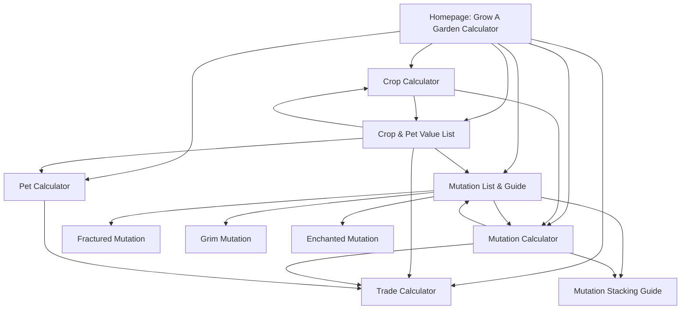

# SEO internal linking plan

This plan uses the queries and landing pages visible in Google Search Console for August 9–November 8, 2026, plus the keyword targets already present in the site. It groups close variants around one best destination so two pages do not compete for the same intent.

## Page hierarchy

The homepage stays the main calculator hub. The value list, pet calculator, crop calculator, mutation guide, and mutation calculator each serve a distinct task. Item detail pages should link back to their matching hub and to the next useful calculator.

## Search Console keyword map

| Keyword cluster from Search Console | Best destination | Useful source pages | Example contextual anchor |
| --- | --- | --- | --- |
| “grow a garden calculator”, “gag calculator”, “calculator gag”, “gag kalkulator” | `/` | Crop, pet, value, mutation, and trade tools | Grow A Garden Calculator |
| “grow a garden values”, “gag values” | `/value-list` | Homepage, crop calculator, pet calculator, trade calculator | Grow A Garden crop and pet values |
| “grow a garden mutations”, “gag mutations” | `/mutation-guide` | Homepage, value list, mutation calculator | Grow A Garden mutation list and multipliers |
| “fractured mutation multiplier”, “fractured mutation”, “fractured mutation grow a garden” | `/mutation/fractured` | Homepage, mutation guide, mutation calculator, trade calculator | Fractured mutation multiplier (×92) |
| “grim mutation” | `/mutation/grim` | Mutation guide combo table and mutation directory | Grim mutation (×170) |
| “enchanted mutation multiplier” | `/mutation/enchanted` | Mutation guide and mutation calculator directory | Enchanted mutation multiplier (×50) |
| “gag pet calculator” | `/pet-calculator` | Homepage, value list, trade calculator | GAG pet calculator |
| Crop-specific value searches, including Dragon Fruit | `/crop/[slug]-value` | Value list and relevant crop/calculator pages | Dragon Fruit value in Grow A Garden |
| Trade calculator searches | `/trade-calculator` | Crop calculator, pet calculator, value list, mutation calculator | GAG trade calculator |
| Mutation stacking and multiplier searches | `/mutation-stacking-guide` or `/mutation-calculator` | Mutation guide, crop calculator | mutation stacking guide / mutation calculator |

The Search Console baseline shows why the mutation guide gets priority: it had 17,628 impressions, 138 clicks, a 0.8% CTR, and average position 6.8 in the selected three-month period. The query “enchanted mutation multiplier” showed 382 impressions and one click on that page. The specific Fractured page is already a stronger performer, with 8,540 impressions and 153 clicks, so keep its existing links and avoid unnecessary rewrites.

## Implementation details

1. **Link from the relevant answer, not from every page.** Add a link in the paragraph or table that answers the reader’s question. Keep one clear destination per intent cluster.
2. **Use descriptive, varied anchors.** On the mutation guide, use the exact mutation name and multiplier once. Elsewhere use natural variations such as “mutation detail page” or “calculate a mutation stack.” Do not repeat the same keyword in every footer or card.
3. **Keep the tools connected to the next task.** The crop calculator should link to the mutation calculator and value list; pet and value pages should link to the trade calculator; the mutation guide should link to the mutation calculator and stacking guide.
4. **Preserve working links.** The homepage and tool pages already link to the main hubs, the value list links to crop, pet, trade, and mutation tools, and the mutation calculator links to its mutation directory. Keep those contextual links.
5. **Specific mutation links added.** The mutation guide now links directly to Enchanted, Grim, and Fractured detail pages. This supports the observed query cluster without adding another broad mutation page.
6. **Check routes when adding a link.** Dynamic mutation routes must use an ID present in `src/data/mutations.ts`; crop detail routes use `/crop/{crop-id}-value`. Use Next.js `<Link href="/route">descriptive anchor</Link>` for internal links.

The update dates use the latest Git commit that changed the relevant page or dataset. The Vercel build step attempts to expand its default shallow Git history so older source dates stay available; if Git history cannot be fetched, the build continues and omits dates it cannot support (the three data files have known baseline dates as a fallback). A new Vercel deployment by itself does not change the displayed data dates.

## How to measure the change

In Search Console, compare the same 28-day and previous 28-day ranges after Google has recrawled the updated pages. Review the Queries tab for the keyword clusters above and the Pages tab for `/mutation-guide`, `/mutation/enchanted`, `/mutation/grim`, `/mutation/fractured`, `/pet-calculator`, and `/`. Track clicks, impressions, CTR, and average position together; a link change can improve discovery and relevance, but it does not guarantee a ranking or traffic increase.
